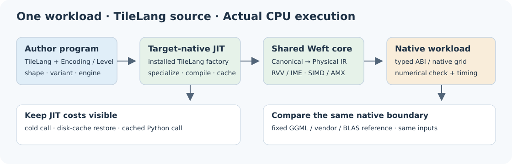

# TileLang–Weft Bench

[中文](README.zh-CN.md) · [TileLang–Weft](https://github.com/Tianchen-ai/tilelang-weft)

Native TileLang author programs measured with the shared Weft Bench engine.

The four suites contain 553 operator–platform cases: SG2044 133, K1 137,
K3 A100 136 and x86 147. There are 543 matched external references.

The product owns the kernels and compiler. This package owns TileLang source
bindings and comparison selections, and reuses `weft_bench` inputs, numerical
checks, native timers, target execution and result storage.

```sh
python -m pip install --find-links ./wheels ./wheels/tilelang_weft_bench-*.whl
tilelang-weft-bench list --kind targets
tilelang-weft-bench list --kind kernels --target k3-a100
tilelang-weft-bench show q4_k_dot --target x86-1t --config bench.local.json
tilelang-weft-bench op q4_k_dot --target x86-1t --config bench.local.json \
  --output output/current/x86-1t/q4_k_dot
```

Install matching TileLang–Weft and `weft-core` packages on each execution host.
Local configuration names CPUs, toolchains, reference libraries and SSH paths;
it stays outside version control. Measurements run through target-native JIT.

Performance results: **Under evaluation / 测试中**.

[Bilingual handbook](https://tianchen-ai.github.io/tilelang-weft-bench/) ·
[Program and timing contracts](docs/contracts.md) · [Reproduction](docs/reproduction.md)
