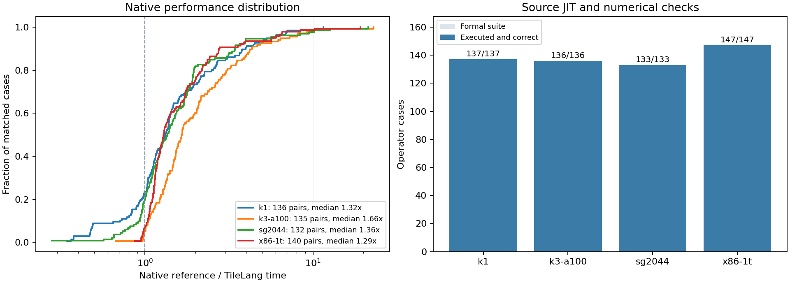
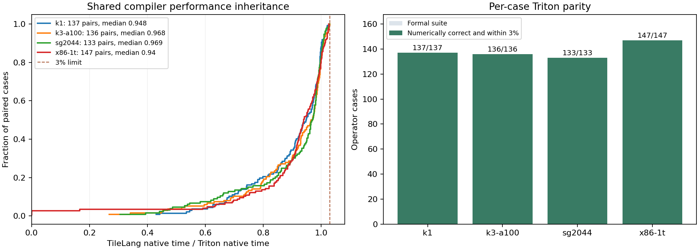

# TileLang–Weft Bench

[中文](README.zh-CN.md) · [TileLang–Weft](https://github.com/Tianchen-ai/tilelang-weft) ·
[Gitee mirror](https://gitee.com/dongshan-community/tilelang-weft-bench)

Native TileLang author programs measured with the shared Weft Bench engine.

The four suites contain 553 operator–platform cases: SG2044 133, K1 137,
K3 A100 136 and x86 147. There are 543 matched external references.

The product owns the kernels and compiler. This package owns TileLang source
bindings and comparison selections, and reuses `weft_bench` inputs, numerical
checks, native timers, target execution and result storage.

Start from a CPU PyTorch environment. Resolve dependencies, then install the
coordinated release wheels while retaining that dependency environment:

```sh
gh release download weft-parity --repo Tianchen-ai/tilelang-weft \
  --pattern '*.whl' --dir wheels
gh release download weft-parity --repo Tianchen-ai/tilelang-weft-bench \
  --pattern '*.whl' --pattern constraints.txt --dir wheels
python -m pip install --find-links ./wheels -c ./wheels/constraints.txt \
  tilelang tilelang-weft-bench
python -m pip install --force-reinstall --no-deps --no-index --find-links ./wheels \
  -c ./wheels/constraints.txt tilelang weft-core triton-weft-bench tilelang-weft-bench
tilelang-weft-bench list --kind targets
tilelang-weft-bench list --kind kernels --target k3-a100
tilelang-weft-bench show q4_k_dot --target x86-1t --config .local/bench.local.json
tilelang-weft-bench op q4_k_dot --target x86-1t --config .local/bench.local.json \
  --output output/current/x86-1t/q4_k_dot
```

Install matching TileLang–Weft and `weft-core` packages on each execution host.
The [configuration template](configs/local.example.json) names CPUs, toolchains,
reference libraries and SSH paths; save its configured copy in `.local/bench.local.json`.
Machine configuration stays outside version control. Measurements run through target-native JIT.

The [results handbook](docs/results.md) explains numerical coverage, timing
boundaries and the measured implementation gaps. Original samples accompany the
full operator CSV.

## Performance results



| Platform | JIT + numerical checks | Matched refs | Faster than ref | Median native speedup |
|---|---:|---:|---:|---:|
| SG2044 | 133/133 | 132 | 106 | 1.3598× |
| K1 | 137/137 | 136 | 104 | 1.3176× |
| K3 A100 | 136/136 | 135 | 128 | 1.6569× |
| x86 | 147/147 | 140 | 130 | 1.2917× |
| **Total** | **553/553** | **543** | **468** | — |



All **553/553** native comparisons meet **TileLang time ≤ Triton time × 1.03**.
The checked source-JIT artifact and retained Triton control run in alternating
order on shared inputs. Speedup against an external library is
**matched native reference time / TileLang native time**. The chart
includes every matched formal case. Native computation, cold JIT, fresh-process
cache restoration and Python calls have separate columns in the
[operator CSV](docs/assets/operators.csv). The [results handbook](docs/results.md)
explains numerical-check scope, author programs and the paired timing boundaries.

Branches and tags synchronize to the [Gitee mirror](https://gitee.com/dongshan-community/tilelang-weft-bench)
automatically after GitHub pushes and releases.

[Bilingual handbook](https://tianchen-ai.github.io/tilelang-weft-bench/) ·
[Program and timing contracts](docs/contracts.md) · [Reproduction](docs/reproduction.md)
