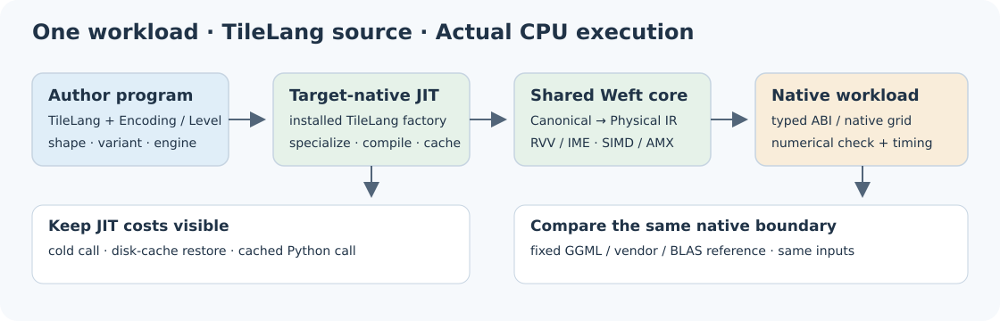
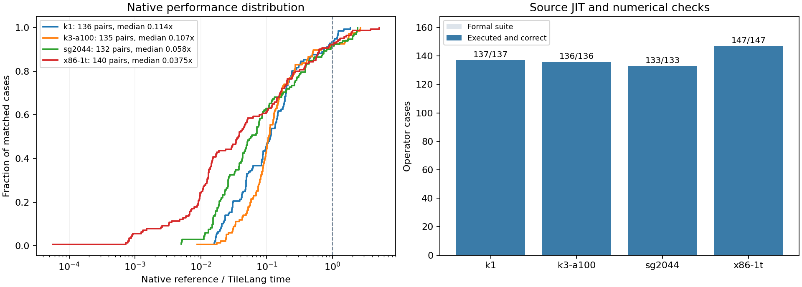

# TileLang–Weft Bench



[English](README.md) · [TileLang–Weft](https://github.com/Tianchen-ai/tilelang-weft) ·
[Gitee 镜像](https://gitee.com/dongshan-community/tilelang-weft-bench)

本项目使用共同 Weft Bench 引擎，对原生 TileLang 作者程序进行算子比较。
四平台套件共 553 项：SG2044 133、K1 137、K3 A100 136、x86 147，
其中 543 项有匹配外部参考。K3 的完整套件包含三项 IME2。

算法与编译器属于产品；本仓库维护 TileLang 源码绑定、比较选择和结果入口。
输入、数值检查、原生计时、SSH 与结果保存复用 `weft_bench`，使用已安装的 TileLang 编译器。

从 CPU PyTorch 环境安装配套发行包：

```sh
gh release download v0.1.15-weft.2 --repo Tianchen-ai/tilelang-weft \
  --pattern '*.whl' --dir wheels
gh release download v0.1.0 --repo Tianchen-ai/tilelang-weft-bench \
  --pattern '*.whl' --pattern constraints.txt --dir wheels
python -m pip install --find-links ./wheels -c ./wheels/constraints.txt \
  tilelang tilelang-weft-bench
tilelang-weft-bench list --kind targets
tilelang-weft-bench list --kind kernels --target k3-a100
tilelang-weft-bench show q4_k_dot --target x86-1t --config .local/bench.local.json
tilelang-weft-bench op q4_k_dot --target x86-1t --config .local/bench.local.json \
  --output output/current/x86-1t/q4_k_dot
```

各执行机安装匹配的 TileLang–Weft、`weft-core` 与 Bench 包。
[配置模板](configs/local.example.json) 保存核心、工具链、参考库和 SSH 位置；
填写后保存为 `.local/bench.local.json`，不进入 Git。
完整用例通过目标机 JIT 执行，编译、Python 热调用与原生计算分别记录。

[结果工具书](docs/results.zh-CN.md) 说明数值范围、计时边界和实际实现差距。
原始样本与完整算子 CSV 一起提供。

## 性能结果



| 平台 | JIT 与数值检查 | 匹配参考 | 快于参考 | 原生倍率中位数 |
|---|---:|---:|---:|---:|
| SG2044 | 133/133 | 132 | 11 | 0.0580× |
| K1 | 137/137 | 136 | 9 | 0.1143× |
| K3 A100 | 136/136 | 135 | 10 | 0.1074× |
| x86 | 147/147 | 140 | 11 | 0.0375× |
| **合计** | **553/553** | **543** | **41** | — |

倍率为 **匹配参考原生耗时 / TileLang 原生耗时**，图中包含每项匹配的正式用例。
[算子 CSV](docs/assets/operators.csv) 分别记录原生计算、冷 JIT、新进程缓存恢复和
Python 调用。[结果工具书](docs/results.zh-CN.md) 说明数值检查范围，以及当前
packed dot/projection 的性能差距。

GitHub 的分支和 tag 会在 push、发布 Release 后自动同步到
[Gitee 镜像](https://gitee.com/dongshan-community/tilelang-weft-bench)。
