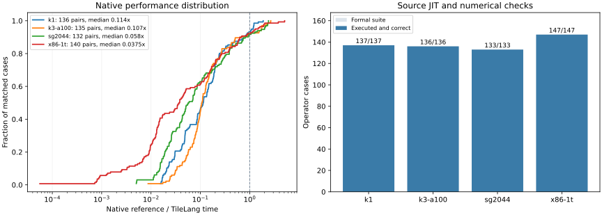
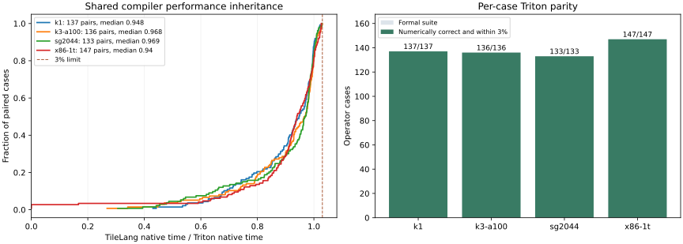

# Operator results

[中文](results.zh-CN.md) · [Contracts](contracts.md) · [Reproduce](reproduction.md)

The four formal suites share 150 workload IDs with Triton–Weft. Each selected
TileLang program ran through ordinary source JIT on the execution machine,
numerical checking, fresh-process cache restoration and native measurement.



[Full operator CSV](assets/operators.csv) · [Summary](assets/summary.json) ·
[Original candidate and reference samples](assets/observations.json) ·
[Build and observation provenance](assets/provenance.json) ·
[Per-case final emission comparison](assets/compiler-emission.json)

## Coverage and native performance

All 553 cases completed their target-native source JIT and numerical checks.

| Platform | JIT + numerical checks | Matched refs | Faster than ref | Median native speedup |
|---|---:|---:|---:|---:|
| SG2044 | 133/133 | 132 | 106 | 1.3598× |
| K1 | 137/137 | 136 | 104 | 1.3176× |
| K3 A100 | 136/136 | 135 | 128 | 1.6569× |
| x86 | 147/147 | 140 | 130 | 1.2917× |
| **Total** | **553/553** | **543** | **468** | — |

Speedup is **matched reference native time / TileLang native time**. Values above
one favor TileLang. The platform median gives each matched case one observation.
Dot leaves, complete projections and matrix tiles retain their own `scope` in
the CSV and detailed summary. The ten reference gaps retain numerical checks
and native timings with an empty external ratio.

| Reference gap | Platform cases |
|---|---:|
| `causal_attention`, one on each platform | 4 |
| `ime_centered`, `ime_centered_decode`, `ime_affine`, `ime_affine_decode` on x86 | 4 |
| `f16_projection_decode`, `f16_projection_prefill` with activation conversion on x86 | 2 |

These entries have no retained external observation matching the complete
contract. The separately registered x86 F16 variants preserving F32 activations
have their own matched comparisons.

## Triton performance inheritance



The selected 553 cases have a matched Triton control. Each TileLang native
latency is at most **1.03 ×** its corresponding Triton latency. The control and
candidate run in alternating order on shared inputs. The candidate is the exact
native library exported by the checked TileLang source JIT.

The two K3 Q1 controls were rebuilt from their retained Triton Canonical programs
after the shared compiler's exact signed-I8 reduction repair. The older controls
overflowed when negating `-128`; the endpoint input produced `-2048` instead of
`0`. Both corrected frontends pass that input. `triton_historical_us` preserves
the older timing, and `triton_control_note` identifies the corrected comparisons.

| Platform | Matched native pairs | Within 3% |
|---|---:|---:|
| SG2044 | 133 | 133/133 |
| K1 | 137 | 137/137 |
| K3 A100 | 136 | 136/136 |
| x86 | 147 | 147/147 |
| Total | 553 | 553/553 |

`native_us` and `triton_native_us` come from these pairs. External references
retain their fixed library and observation identity: their ratio uses
`reference_us / reference_candidate_us`. Cold JIT, cache restoration and Python
calls have their own columns and are outside both native comparison windows.

## Author programs and shared compilation

TileLang imports native TIRx into the same Canonical compiler used by
Triton–Weft. The complete packed workload retains its input preparation,
Encoding, integer partials, scale/min branches and output update. Formal
bindings select the program, tiling, preparation protocol and physical options
for each target.

- Short records and K/IQ formats use bounded entry/payload or plane Levels.
  Typed I16/I32 partials finish before the declared floating update. Source
  parameters expose record windows, row cohorts and reuse scopes.
- Complete projections retain activation quantization inside the invocation.
  Explicit weight and activation stages share encoded panels across the
  author's row/column cohort. Persistent derived layouts have a separately
  declared preparation protocol.
- IME1, IME2, VNNI and AMX variants express their operand layouts and local
  contraction intent in the author program. Shared physical passes select
  instructions, local packing, conversions and resource handling.
- Dynamic rotary traversal preserves runtime extents and both input snapshots
  before output stores. Indexed programs retain explicit lookup widths and
  record metadata reads; the Encoding supplies their storage geometry.

Frontend repairs preserve scalar SSA, helper axes, identity slices, field
projections and loop carries. Shared compiler repairs close scalar tuple packs,
Boolean comparison layouts, integer reductions, alias facts and capture
liveness. Grouped dense-memory transfers normalize the selected carrier before
reading or writing; matrix-result pointwise operations preserve the ordered
logical lane coordinates even when both operands occupy equally wide vectors.
The compiler lowers these typed programs without dispatching by
kernel or quantization-format name. Clang 23 settings are recorded per candidate.

Shared widening reductions keep their declared integer partials. Their zero
identity is a read-only RVV intrinsic operand, so LLVM can reuse it across the
loop while the selected assembly preserves the reduction order. On SG2044,
Q6_K dot measures **1.060 µs TileLang / 1.054 µs Triton** in the matched pair;
the generated code removes repeated seed initialization and vector-state work.

For indexed entry loads, the reduction selector also checks the complete live
set and a bounded typed producer chain. When independent reductions fit, their
intrinsics remain visible to LLVM so lookup supply can overlap computation.
This consumes the existing physical operations, axes and lifetimes.

For K1 Q2_K prefill, the selected author program folds each U2 code and U4 scale
into an invocation-local I8 panel, whose exact range is `[0, 45]`. A matrix
contraction consumes that panel across activation rows; the I16 block-sum
correction keeps its vector route. The complete alternating native pair is
**976.196 ms TileLang / 1446.994 ms Triton**, or **1.482×** over the retained Triton
program. Activation quantization and panel population are included. The source
organization provides the reuse; the common compiler preserves its Encoding,
matrix layout, numerical branches and lane coordinates.

## Numerical coverage and execution evidence

Integers and serialized Encoding fields use exact checks. Floating-point results
retain each workload's existing tolerance. Projection decode checks every output
column; prefill checks the established 64-output sample and finiteness of every
output. Activation bytes follow the declared target rounding contract.

Every final row requires cold JIT, reuse of the compiled kernel, fresh-process
disk-cache restoration, Python hot-call timing, native samples and agreement with
the formal source binding. Source-equivalence audits identify observations
retained across documentation changes or unchanged Canonical programs; their
original package version remains recorded.

Canonical and Physical audits identify programs affected by a compiler or author
change. Targeted installed-package runs validate those paths; unchanged programs
retain their original observations and package identity. Source bindings and
the shared core revisions are recorded in the provenance export.

The final compiler reimports all 553 selected original TIRx programs. Generated
bodies match their checked artifacts: 357 are identical, and 196 differ only
by read-only `restrict` qualifiers. Changed executable bodies were checked with
the installed package and paired before selection. This preserves the measured
evidence without repeatedly timing unchanged programs.

`used_extensions` records IME/AMX requirements from the artifact.
`selected_physical_engines`, architecture, VLEN and resource metadata describe its
lowering. Conditional runtime instruction observations have a separate field.

## Reference sources

| Platform | Selected native reference |
|---|---|
| SG2044 | Retained GGML CPU/RVV source and Clang 23 Release build |
| K1 | Retained GGML CPU/RVV build and its SpacemiT IME1 entries |
| K3 A100 | GGML/SpacemiT revision `6df9f75`, recorded RVV patches and IME2 entries |
| x86 | GGML revision `620d222`; oneDNN `3.13.4` for the two selected typed dense cases |

The shared engine's [reference catalog](https://github.com/Tianchen-ai/triton-weft-bench/blob/main/src/weft_bench/catalogs/references.json)
defines source locations, function boundaries and preparation protocols. Each
baseline retains its original build and observation; this campaign reuses those
measurements under the matched contract. OpenBLAS remains an available registered
reference, while this formal selection uses the entries listed above.

`observations.json` publishes the original candidate, reference and matched
independent Triton samples,
shapes, input policies, numerical-check scope and native timing options. Private
execution paths are omitted. It accompanies the tables; the engine's local fixed
baseline indexes retain the full original comparison identity. Available source
bindings and producer versions identify the programs behind each sample set.

## Repairs included

Compiler repairs cover encoded field-write coordinates, masked local stores,
masked-load extents, unsigned RVV shifts, stale indexed-load planning and
axis-renamed Encoding subwindows. Q4_K/Q6_K typed partials retain their scale and
correction branches. An x86 short-halfword repair resolves an LLVM 23
instruction-selection crash in legal IQ1_S programs.

The shared Bench engine reuses immutable generated inputs across cold/cache
checks and native execution. It records the actual Python sampling budget and
resolves per-case native timing settings identically for individual and full-suite
runs. Fixed reference libraries and original numerical contracts are retained.

## Reproduce a row

Identify the program with `target`, `case`, `shape`, `scope`, `source_parameters`
and `backend_options`. The two native comparisons retain their own samples:

- `native_us / triton_native_us` is the TileLang/Triton inheritance ratio from
  alternating calls in the same session. Each case passes at or below 1.03.
- `reference_us / reference_candidate_us` is the external-reference speedup.
  `reference_candidate_us` is the source-JIT run's exported native workload;
  `reference_match` identifies its matched fixed reference.

All samples remain available in `observations.json`. Timings from the two
comparison sessions are not mixed into a third ratio.
`cold_jit_ms`, `disk_cache_restore_ms`, `first_cache_hit_ms` and `python_hot_ms`
describe the separate user-facing JIT path.
The cold and fresh-process cache metrics include their first complete workload
call. They measure compile-and-launch or restore-and-launch, respectively;
the native/reference ratio uses only the native workload samples.
`compiler_api_ms` and `first_call_outside_compiler_ms` split the cold call using
the existing JIT events. Child-process CPU metrics and original compilation/cache
events accompany the observations, so a long workload call remains distinguishable
from compilation work.

```sh
tilelang-weft-bench show q4_k_projection_decode --target k1 --config .local/bench.local.json
tilelang-weft-bench op q4_k_projection_decode --target k1 --config .local/bench.local.json \
  --baseline output/baselines/k1 --output output/current/k1/q4_k_projection_decode
```

[Reproduction](reproduction.md) covers fixed references, complete suites,
explicit observation selection and regeneration of the table.
