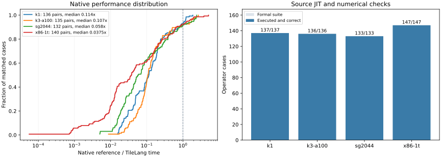

# 算子结果

[English](results.md) · [测量合同](contracts.zh-CN.md) · [复现](reproduction.zh-CN.md)

四个正式套件与 Triton–Weft 共用 150 个 workload ID。每个选定的 TileLang
程序都在执行机通过普通源码 JIT 运行，完成数值检查、新进程缓存恢复和原生计时。



[完整算子 CSV](assets/operators.csv) · [汇总](assets/summary.json) ·
[候选与参考原始样本](assets/observations.json) ·
[构建与测量来源](assets/provenance.json)

## 覆盖范围与原生性能

553 项全部完成目标机普通源码 JIT 和数值检查。

| 平台 | JIT 与数值检查 | 匹配参考 | 快于参考 | 原生倍率中位数 |
|---|---:|---:|---:|---:|
| SG2044 | 133/133 | 132 | 11 | 0.0580× |
| K1 | 137/137 | 136 | 9 | 0.1143× |
| K3 A100 | 136/136 | 135 | 10 | 0.1074× |
| x86 | 147/147 | 140 | 11 | 0.0375× |
| **合计** | **553/553** | **543** | **41** | — |

倍率定义为 **匹配参考原生耗时 / TileLang 原生耗时**，大于 1 表示 TileLang 更快。
平台中位数对每个匹配用例取一个观测。单个 dot、完整 projection 和矩阵 tile
各自的计算范围保留在 CSV 的 `scope` 和详细汇总中。10 项参考缺口保留数值检查与
原生耗时，外部参考倍率留空。

| 参考缺口 | 平台用例数 |
|---|---:|
| 每个平台各一项 `causal_attention` | 4 |
| x86 的 `ime_centered`、`ime_centered_decode`、`ime_affine`、`ime_affine_decode` | 4 |
| x86 包含 activation 转换的 `f16_projection_decode`、`f16_projection_prefill` | 2 |

这些入口没有与完整合同匹配的已保留外部观测。x86 另外登记的保留 F32 activation
的 F16 变体有各自匹配的参考比较。

## 性能差距的具体表现

归一化和 activation 量化已经从共享向量编译器获得收益。例如，x86 LayerNorm
达到 3.80×、softmax 达到 5.10×；SG2044 RMSNorm 为 1.71×、LayerNorm 为 2.40×。
这些倍率均使用各自匹配的原生参考。packed dot、完整
projection 和部分序列化矩阵程序仍存在显著差距。原生耗时直接展示这些差距，
冷编译和 Python 调用分别列出。

当前作者程序包含几个与性能有关的明确选择：

- [`packed.accumulate`](https://github.com/Tianchen-ai/tilelang-weft/blob/v0.1.15-weft.2/tilelang/weft/kernels/packed.py)
  为 Q4_K/Q6_K 使用 typed 整数 partial，再以 F64 缩放累加。通用 codebook
  路径每次解码 32 个值，转换为 F64，并逐段归约。
- `packed.projection` 在每次调用内量化 activation，然后遍历 activation 行、
  输出列组和 packed record。权重解码位于这棵循环树内部，限制了跨 activation 行复用。
- [`matrix.packed_x86`](https://github.com/Tianchen-ai/tilelang-weft/blob/v0.1.15-weft.2/tilelang/weft/kernels/matrix.py)
  为每个量化组构造 64 元素操作数。矩阵指令加速 contraction；操作数构造、packing
  和逐组更新仍属于完整 workload。

这些是源码和生成程序中的事实；各部分的耗时贡献需要定向优化测量确认。保留的产物和
源码参数可用于直接复现。Triton 耗时作为独立对照列保留，作者实现的差异明确列出。

## 数值范围与执行证据

整数和序列化 Encoding 字段按精确合同检查；浮点结果沿用 workload 已有容差。
projection decode 检查每个输出列；prefill 使用已有的 64 输出抽样，同时检查全部
输出的有限性。activation 字节遵循声明的目标舍入合同。

最终每行都要求冷 JIT 成功、复用同一编译 kernel、新进程磁盘缓存恢复、Python
热调用耗时、原生样本，以及与正式源码绑定一致。源码等价核对明确标识文档修改或
Canonical 程序未变时继承的测量；记录保留原包版本。

x86 编译器修复另外使用前后两版 core 降低了全部 147 份 Canonical 程序：4 份 LLVM
模块变化，对应 4 项已重新执行；其余 143 份相同。最新 core 改动限于 x86 物理 passes。

`used_extensions` 来自产物的 IME/AMX 要求；`selected_physical_engines`、
架构、VLEN 和资源 metadata 展示 lowering。条件指令路径的运行观察另列。

## 参考来源

| 平台 | 选定的原生参考 |
|---|---|
| SG2044 | 已保留的 GGML CPU/RVV 源码与 Clang 23 Release 构建 |
| K1 | 已保留的 GGML CPU/RVV 构建及其 SpacemiT IME1 入口 |
| K3 A100 | GGML/SpacemiT `6df9f75`、已登记的 RVV 补丁与 IME2 入口 |
| x86 | GGML `620d222`；两个选定的 typed dense 用例使用 oneDNN `3.13.4` |

共同引擎的[参考目录](https://github.com/Tianchen-ai/triton-weft-bench/blob/main/src/weft_bench/catalogs/references.json)
定义源码、调用边界与准备协议。各 baseline 保留原构建和原观测，本轮按匹配合同复用。
OpenBLAS 仍是已登记的可选参考；本次正式选择使用上表中的入口。

`observations.json` 公开候选、参考及匹配的独立 Triton 对照的原始样本、shape、输入策略、数值检查范围和
原生计时参数，移除机器私有路径，供表格核对使用。引擎的本地固定 baseline 索引
继续保留完整的原始比较身份。文件保留可取得的源码绑定和 producer 版本，便于定位实际程序。

## 本轮修复

修复覆盖 Encoding 字段写入坐标、带 mask 的局部更新、masked load 有效范围、
RVV 无符号移位、失效的 indexed-load 决定，以及逻辑轴重命名后的 Encoding 子窗口。
Q4_K/Q6_K typed partial 保留缩放与修正分支。x86 短 halfword 修复解决了合法
IQ1_S 程序触发的 LLVM 23 指令选择崩溃。

共同 Bench 引擎跨冷 JIT、缓存检查和原生执行复用不可变输入，记录 Python
实际采样预算，并对单项和完整套件使用相同的逐 case 原生计时配置。固定参考库和
原数值合同保持原有身份。

## 复现一项结果

通过 `target`、`case`、`shape`、`scope`、`source_parameters` 和
`backend_options` 确定程序。两种原生比较分别保留各自的样本：

- `native_us / triton_native_us` 是同场交替调用得到的 TileLang/Triton
  性能继承比例，每项不超过 1.03 才达标。
- `reference_us / reference_candidate_us` 是外部参考倍率。
  `reference_candidate_us` 来自源码 JIT 运行后导出的原生 workload，
  `reference_match` 标明与之匹配的固定参考。

`observations.json` 保留全部样本，不把两场比较的耗时混成第三个倍率。
`cold_jit_ms`、`disk_cache_restore_ms`、`first_cache_hit_ms` 和
`python_hot_ms` 分别描述正常用户 JIT 路径。
冷调用和新进程缓存指标都包含第一次完整 workload 调用，分别对应编译并启动、
恢复并启动。原生参考倍率仅使用原生 workload 样本。
`compiler_api_ms` 和 `first_call_outside_compiler_ms` 按已有 JIT 事件拆分冷调用；
同时公开编译子进程 CPU 耗时和原始编译、缓存事件，便于区分计算耗时与编译工作。

```sh
tilelang-weft-bench show q4_k_projection_decode --target k1 --config .local/bench.local.json
tilelang-weft-bench op q4_k_projection_decode --target k1 --config .local/bench.local.json \
  --baseline output/baselines/k1 --output output/current/k1/q4_k_projection_decode
```

[复现说明](reproduction.zh-CN.md) 包含固定参考、完整套件、显式结果选择和全量表生成命令。
